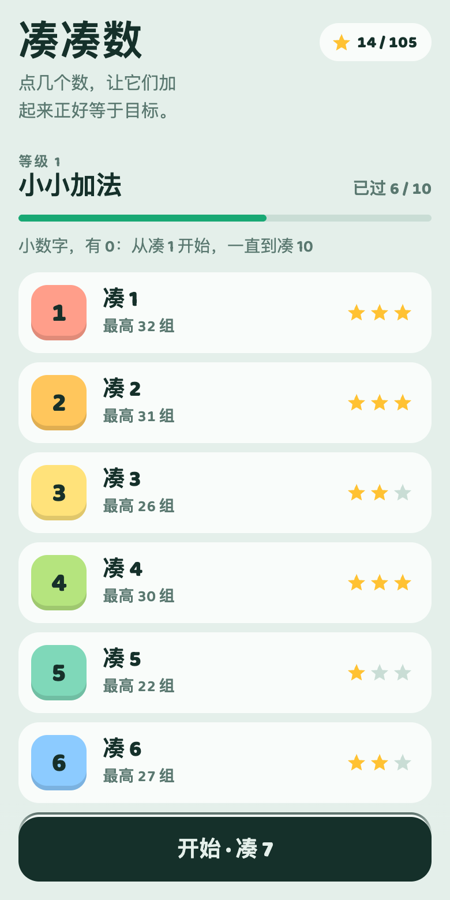
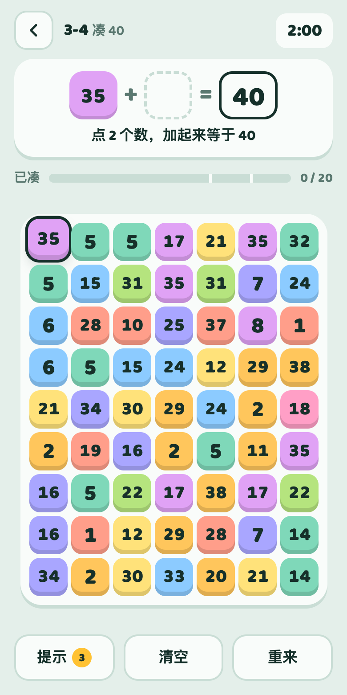

# 凑凑数 Sum Pop

一个数字配对小游戏：在棋盘上点几个数，让它们加起来正好等于目标数，凑出一组就消掉。限时内凑够组数就过关，凑得越多星星越多。

*A number-matching puzzle: tap numbers that add up to the target before time runs out. Bilingual (中文 / English), built as a web page and packaged as an iOS app with [Capacitor](https://capacitorjs.com/).*

<p>
  
  &nbsp;
  
</p>

关卡从"凑 1"开始，一直到凑 100，后面还有负数和小数：

| 等级 | 内容 |
|---|---|
| 1 小小加法 | 凑 1 到 10，有 0，限时 45 秒，发呆会自动提示（给小朋友） |
| 2 凑十几 | 凑 11 到 20 |
| 3 凑整十 | 凑 10、20 …… 100 |
| 4 负数登场 | 带斜纹的是负数，一次最多点 3 个 |
| 5 小数点 | 目标是小数 |

---

## 只想玩一下：用浏览器（不需要 Mac）

游戏本身就是网页，不用安装任何东西。

**在电脑上玩：** 下载代码后，直接用浏览器打开 `www/index.html`。

```sh
git clone https://github.com/sslcandoit/sum-pop.git
open sum-pop/www/index.html        # Windows 上双击这个文件即可
```

**在手机浏览器里玩：** 在电脑上开一个本地网页服务，手机和电脑连同一个 Wi-Fi 就能打开。

```sh
cd sum-pop
python3 -m http.server 8000 -d www
```

然后在手机浏览器里打开 `http://<电脑的局域网 IP>:8000`。Mac 可以用 `ipconfig getifaddr en0` 查 IP。在 Safari 里点"分享 → 添加到主屏幕"，用起来就和 App 差不多。

浏览器版和 App 版的玩法完全一样，区别只是 App 有 iPhone 的震动反馈。进度保存在当前浏览器里。

---

## 装到自己的 iPhone 上

### 需要准备

- 一台 Mac，装好 **Xcode 26** 或更新版本（在 App Store 免费下载）
- **Node.js 22** 或更新版本（[nodejs.org](https://nodejs.org/) 或 `brew install node`）
- 一个 Apple ID。免费的就行，不需要付费开发者账号
- iPhone 系统 **iOS 15** 或更新版本，以及一根数据线（第一次需要用线连接）

### 步骤

**1. 下载代码，安装依赖，打开 Xcode**

```sh
git clone https://github.com/sslcandoit/sum-pop.git
cd sum-pop
npm install
npm run ios          # 把 www/ 同步到 iOS 工程，然后打开 Xcode
```

**2. 在 Xcode 里改成你自己的签名**

这个工程里的签名设置是作者的，你的电脑用不了，需要改两处：

1. 如果还没登录过 Apple ID：打开 Xcode 菜单 **Settings → Accounts**，点左下角 **+** 添加你的 Apple ID。
2. 左侧点最上面的 **App** 项目，中间选 **TARGETS → App**，切到 **Signing & Capabilities** 标签页：
   - **Team**：选你自己的名字，后面带 "(Personal Team)" 的那个就是免费账号。
   - **Bundle Identifier**：把 `com.sslee.sumpop` 改成你自己的，比如 `com.你的名字.sumpop`。这个标识已经被作者的账号占用了，不改的话会签名失败。

**3. 打开 iPhone 的开发者模式**

1. 用数据线把 iPhone 连到 Mac，手机上弹出"要信任此电脑吗"时选 **信任**。
2. 在 iPhone 上打开 **设置 → 隐私与安全性 → 开发者模式**，打开它，手机会重启。重启后再确认一次。
   如果找不到这个选项，先完成下一步点一次运行，选项就会出现。

**4. 运行**

在 Xcode 窗口顶部选择你的 iPhone 作为运行目标，点 **▶ 运行**（或按 ⌘R）。编译完成后，App 会自动安装到手机上并打开。

第一次打开时如果提示"**不受信任的开发者**"：在 iPhone 上打开 **设置 → 通用 → VPN 与设备管理**，点你的 Apple ID，再点 **信任**。然后回到主屏幕重新打开 App。

> **免费 Apple ID 的限制：** 用免费账号安装的 App **7 天后会失效**，打不开了。到时把手机连上 Mac，在 Xcode 里再点一次运行就行，游戏进度不会丢。付费开发者账号安装的 App 有效期是一年。

**不想每次都打开 Xcode？** 签名设置好以后，也可以在命令行里安装：

```sh
npx cap run ios --list               # 列出可用的设备
npx cap run ios --target <设备 ID>
```

---

## 修改游戏

| 文件 | 内容 |
|---|---|
| [`www/levels.js`](www/levels.js) | **所有关卡的配置**。调难度、加关卡只需要改这个文件，每个字段的含义写在文件开头 |
| [`www/i18n.js`](www/i18n.js) | 中英文界面文字 |
| [`www/game.js`](www/game.js) | 玩法、渲染、首页、存档 |
| [`www/style.css`](www/style.css) | 样式 |
| [`www/index.html`](www/index.html) | 页面结构 |
| [`design/make_icons.py`](design/make_icons.py) | 生成 App 图标和启动画面（需要 `pip install pillow`） |
| `ios/` | Xcode 工程，一般不用手动改 |

**改关卡的注意事项：**

- 每关的 `key`（比如 `'tens-40'`）是存档用的名字，**发布后不要再改**，改了玩家这一关的星星和最高纪录就丢了。插入、删除、调换关卡的顺序都没关系，界面上的编号会自动重排。
- 改完后在浏览器里打开 `www/index.html?check`，页面上会列出配置里的错误，比如 key 重复、字段名拼错、数字池凑不出目标。

**调试用的网址参数：**

- `index.html?level=2-3`：直接进入第 2 级第 3 关，也可以用 key，比如 `?level=tens-40`
- `index.html?level=2-3&result=25`：直接看"凑出 25 组"时的结算画面

**改完后更新手机上的 App：** 修改 `www/` 里的文件后，手机上的 App 不会自动更新。先运行

```sh
npm run sync
```

把改动复制进 iOS 工程，然后在 Xcode 里重新点一次 **▶ 运行**。只运行 `sync` 是不够的，手机上还是旧版本。

---

## 发布到 App Store / TestFlight（维护者）

### 前提

- 加入 [Apple Developer Program](https://developer.apple.com/programs/)（每年 99 美元）。免费账号不能发布。
- 在 [App Store Connect](https://appstoreconnect.apple.com/) 里新建 App，Bundle ID 选 `com.sslee.sumpop`。

### 发布前检查

- [ ] 首页的"**解锁全部关卡（测试用）**"按钮现在对所有玩家都可见，正式发布前要隐藏或删掉（在 `www/index.html` 的 `#unlockBtn`）
- [ ] 打开 `www/index.html?check`，确认关卡配置没有报错
- [ ] 每关的 `key` 和上一个版本相比没有被改名

### 每次发版的步骤

1. **改版本号。** 在 Xcode 里 **TARGETS → App → General**：
   - **Version**：给玩家看的版本号，比如 `1.0` → `1.1`
   - **Build**：每次上传都必须比上一次大，比如 `1` → `2`
2. **同步网页代码：** `npm run sync`
3. **打包：** Xcode 顶部的运行目标选 **Any iOS Device (arm64)**，然后点菜单 **Product → Archive**。
4. **上传：** 打包完成后会弹出 Organizer 窗口，选中刚才的包，点 **Distribute App → App Store Connect → Upload**。
5. **测试：** 上传后等几分钟到几十分钟，新版本会出现在 App Store Connect 的 **TestFlight** 里。把测试的人加进去，他们装 TestFlight App 就能玩，不需要 Mac。
6. **提交审核：** 在 App Store Connect 里填写截图、描述，选择这个 Build，点"提交以供审核"。
   隐私问卷可以选"**不收集数据**"：游戏不联网，进度只保存在手机本地。
7. **在 git 里记一个版本标签：**

   ```sh
   git tag v1.1
   git push --tags
   ```
